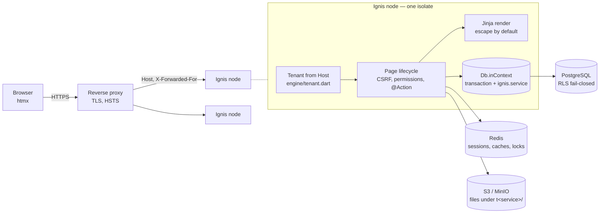

<div align="center">

<picture>
  <source media="(prefers-color-scheme: dark)" srcset="assets/banner.svg">
  <source media="(prefers-color-scheme: light)" srcset="assets/banner-light.svg">
  
</picture>

<h3>Server-rendered, multi-tenant back-office apps in Dart — isolated by PostgreSQL row-level security, declared with annotations.</h3>

[](https://github.com/PawelSzymanski89/ignis/releases)
[](LICENSE)
[](https://dart.dev)
[](https://www.postgresql.org)
[](https://redis.io)
[](#contributing)
[](https://buymeacoffee.com/cygan)

<p>
  <a href="#quick-start"><b>Quick start</b></a> ·
  <a href="#features"><b>Features</b></a> ·
  <a href="SECURITY.md"><b>Docs</b></a> ·
  <a href="#security"><b>Security</b></a> ·
  <a href="CHANGELOG.md"><b>Changelog</b></a>
</p>

</div>

---

Ignis is a Dart package for **server-rendered back-office applications**: pages and entities declared with
annotations, Jinja templates, an `/admin` panel with accounts and permissions, and many services (tenants)
under their own domains in a single install. It ships no domain modules — everything beyond the core is
added by an **application** that depends on `ignis`.

## At a glance

One entity and one panel page — a table with an RLS policy, a route, a menu entry, a permission check and
a POST action, with nothing registered by hand:

```dart
import 'package:ignis/ignis.dart';

@Entity('notes')
class Note {
  int? id;            // primary key — bigserial, assigned by the database
  int service = 0;    // a `service` column ⇒ an RLS policy is created for this table
  String text = '';
}

@Page('/admin/notes',
    template: 'notes.html',   // your templates/notes.html
    requires: 'notes.view',   // declared in Ignis.start(permissions: [...])
    label: 'Notes',           // menu entry, shown only to accounts with `requires`
    icon: 'fe fe-file-text',
    group: 'Content',
    order: 10)
class NotesPage extends AdminPage {
  // runs on POST with triggerAction=add (CSRF already checked by the engine)
  @Action('add')
  Future<bool> add() async {
    if (!can('notes.edit')) return missingPermission('notes.edit');
    await Orm.save(Note()
      ..service = context.service
      ..text = get('text') ?? '');
    return back('/admin/notes', message: 'Saved');
  }

  @override
  Future<void> insertData() async {
    await sharedData(); // menu, signed-in account, flash message
    put('notes', await Orm.pick<Note>(
        'SELECT * FROM notes WHERE service = @s ORDER BY id', {'s': context.service}));
  }
}
```

Every string in the model is HTML-escaped before it reaches the template; `Html(...)` marks trusted markup.

## Table of contents

- [Why Ignis](#why-ignis)
- [Features](#features)
- [Quick start](#quick-start)
- [Your own application](#your-own-application)
- [Architecture](#architecture)
- [Configuration](#configuration)
- [Content-Security-Policy](#content-security-policy)
- [Testing](#testing)
- [Status](#status)
- [Roadmap](#roadmap)
- [Contributing](#contributing)
- [Security](#security)
- [License](#license)
- [Support](#support)

## Why Ignis

<table>
<tr>
<td width="50%" valign="top">

### 🏢 One install, many tenants

The tenant comes from the `Host` header, and PostgreSQL **Row-Level Security is fail-closed** underneath the
application filter: a forgotten `WHERE service = …` returns nothing instead of someone else's data. The node
refuses to start on a superuser or `BYPASSRLS` role.

</td>
<td width="50%" valign="top">

### 🧾 Boring server-side HTML

Pages render on the server and htmx swaps fragments. No SPA build, no client-side state, no inline
JavaScript — so the script policy can be strict: `script-src 'self'`, sent as a **`Content-Security-Policy`
header on every HTML response** and repeated as a `<meta>` in the package layouts.

</td>
</tr>
<tr>
<td width="50%" valign="top">

### 🏷️ Annotations, not glue

`@Page` and `@Entity` give you routes, menu entries, permissions, tables and RLS policies. Nothing has to be
registered by hand, and there is **zero codegen** — the engine reads them through `dart:mirrors`.

</td>
<td width="50%" valign="top">

### 🔐 Secure by default

CSRF on every unsafe method, `__Host-` cookies, login rate limits, AES-GCM-encrypted secrets, an audit log
of every panel action, a request deadline and hardened response headers are on without opting in; a TOTP
second factor is built into the panel.

</td>
</tr>
</table>

## Features

| | Area | What you get |
|---|---|---|
| 🧭 | **Routing** | Page lifecycle `doBeforeProcess → isAbleToSee → processData → @Action (POST only) → insertData → render`; route parameters (`/v1/items/{id}`); per-route methods, body limits and CORS; CSRF, a request deadline and secure default headers |
| 🎨 | **Rendering** | Jinja templates with escaping by default (`Html(...)` for trusted markup), app templates override package ones, versioned static assets (`?v=`), gzip + ETag + 304 for `/assets/` |
| 🗄️ | **Data** | ORM with auto-schema (`update \| validate \| none`) and RLS policies for every table with a `service` column; settings registry with AES-GCM-encrypted secrets; CSV, paging, sorting and date-range components |
| 🔑 | **Auth** | Login with TOTP second factor (RFC 6238), forced password change and rate limits; accounts, permission packages, grants and denials with a panel to manage them; front-end customer accounts (password, reset token, separate session); JWT RS256 and HMAC-signed links |
| 🏢 | **Tenancy** | Tenant resolved from `Host` once per request; a per-request transaction with `ignis.service` set locally; sessions in Redis, so every node behind the load balancer sees the same state |
| 📦 | **Storage** | File storage on S3/MinIO, with metadata and folders in PostgreSQL |
| 🛠️ | **Ops** | Audit log (`audit_log`) for every panel action including its outcome, logins and 2FA; `/health` health check; graceful shutdown; trusted-proxy client address; translations and time zones; console tools for emergencies |

> [!NOTE]
> Ignis uses `dart:mirrors`, so it runs on the Dart VM in JIT mode (`dart run`), not AOT.

## Quick start

**Requirements:** Dart SDK ≥ 3.6, PostgreSQL ≥ 13 and Redis reachable from the node.

```bash
git clone https://github.com/PawelSzymanski89/ignis.git && cd ignis
dart pub get

createdb ignis                     # an empty database; tables appear on first start

# every secret generated, the file readable only by you (it holds the database password and the key)
umask 077
cat > .env <<EOF
IGNIS_KEY=$(openssl rand -hex 32)
IGNIS_DOMAINS=localhost
IGNIS_DB_HOST=127.0.0.1
IGNIS_DB_PASS=$(openssl rand -base64 18)
IGNIS_REDIS_HOST=127.0.0.1
IGNIS_ADMIN_PASS=$(openssl rand -base64 18)
# behind a reverse proxy: its address (IP/CIDR). Unset = X-Forwarded-For ignored, every client looks
# like the proxy — login limits then lock out everyone at once, and the log records only the proxy IP
IGNIS_TRUSTED_PROXIES=127.0.0.1
EOF
chmod 600 .env

set -a && . ./.env && set +a
dart run bin/server.dart           # "Ignis listening on 127.0.0.1:8080" when ready
```

Then:

1. Set the same `IGNIS_DB_PASS` on the PostgreSQL role (`ALTER ROLE ignis PASSWORD '…'`).
2. Open `http://admin.localhost:8080/admin/login`. Browsers resolve `*.localhost` to the loopback and treat
   it as a secure context, so the `__Host-` cookies work without TLS.
3. Log in as `admin` with the `IGNIS_ADMIN_PASS` from `.env`. The panel will require a new password straight
   away. Without `IGNIS_ADMIN_PASS`, a random password is printed once to the console; a supplied one is
   never printed.

> [!IMPORTANT]
> The repository ships templates, the engine's own scripts (`/assets/ignis/`) and brand files, but **not** the
> admin theme's CSS/JS libraries (Bootstrap, htmx, icons). Point `IGNIS_ASSETS` at a directory with them
> (`libs/htmx/htmx.min.js`, `libs/bootstrap/…`); without them the panel renders, but unstyled and without
> htmx navigation.

Session cookies are `__Host-`-prefixed and `Secure`, so outside `localhost` browsers send them only over
HTTPS. Put the node behind a TLS reverse proxy (see
[SECURITY.md](SECURITY.md#sample-reverse-proxy-configuration)).

## Your own application

```dart
// bin/server.dart of your app
import 'package:ignis/ignis.dart';
// ignore: unused_import
import 'package:ignis/entities.dart';
// ignore: unused_import
import 'package:ignis/pages.dart';
// ignore: unused_import
import 'package:my_app/my_app.dart';   // barrel with your pages and entities

Future<void> main() => Ignis.start(
      brand: 'MyApp',
      templates: ['templates'],         // searched before the package templates
      appAssets: ['web/assets'],        // your /assets/…, before IGNIS_ASSETS
      permissions: [('projects.view', 'View projects')],
      settingsSections: [
        Section('api', 'API', 'fe fe-key', 'Integration keys.', [Field('api_token', 'Token', type: FieldType.password)]),
      ],
      languages: ['en', 'pl'],          // i18n/<language>.json; the first is the default
      seed: seedMyApp,                  // runs after the core seed
      tasks: [Queue.start],             // background jobs started after boot
    );
```

- **Pages** extend `PageEngine` / `AdminPage` and carry `@Page(route, template:, requires:, label:,
  group:, order:)`. `@Page(api: true)` is a JSON route without CSRF. `@Page(methods: ['POST'])` returns 405
  for other methods. `@Page(maxBody:)` is the only way a route accepts multipart.
- **Entities** use `@Entity('table', pk:, unique:)`. Tables and columns are created at start-up, but columns
  are never dropped and their types are never changed.
- `dart:mirrors` only sees classes reachable from `main`, so **your barrel must be imported in
  `bin/server.dart`**.
- Templates and static files are overridden by a file with the same name in your directories.

## Architecture



Each request resolves its tenant from `Host` exactly once. It then runs inside a database transaction where
`ignis.service` is set locally, so the RLS policies see the right tenant. The response goes out only after
that transaction commits and its connection has gone back to the pool.

## Configuration

All configuration comes from environment variables read by the engine. The required ones are `IGNIS_KEY`,
`IGNIS_DOMAINS`, `IGNIS_DB_HOST`, `IGNIS_DB_PASS` and `IGNIS_REDIS_HOST`.

<details>
<summary><b>All environment variables</b></summary>

| Variable | Default | Meaning |
|---|---|---|
| `IGNIS_KEY` | **required** | 64 hex chars; AES-GCM key for secrets and HMAC key for signatures. The node refuses to start without it |
| `IGNIS_DOMAINS` | **required** | comma-separated system domains; `admin.<domain>` is the platform panel |
| `IGNIS_DB_HOST` | **required** | PostgreSQL host |
| `IGNIS_DB_PASS` | **required** | PostgreSQL password |
| `IGNIS_DB_PORT` | `5432` | PostgreSQL port |
| `IGNIS_DB_NAME` | `ignis` | database name |
| `IGNIS_DB_USER` | `ignis` | database role — a plain role owning the tables; a superuser or `BYPASSRLS` role is refused at start-up (RLS would not apply) |
| `IGNIS_DB_POOL` | `16` | connection pool size |
| `IGNIS_DB_SSL` | `disable` | `verify-full` = TLS with certificate and host verification, `require` = TLS without verification; other values abort start-up |
| `IGNIS_REDIS_HOST` | **required** | Redis host |
| `IGNIS_REDIS_PORT` | `6379` | Redis port |
| `IGNIS_REDIS_PASS` | — | Redis password |
| `IGNIS_REDIS_TLS` | — | `1` = TLS to Redis, verified against system CAs |
| `IGNIS_PORT` | `8080` | HTTP listen port |
| `IGNIS_NODE` | `node` | node name in logs, locks and the audit log |
| `IGNIS_SCHEMA` | `update` | `update` creates tables and columns, `validate` and `none` only check |
| `IGNIS_ASSETS` | `web/assets` | directory with the theme's static files (`/assets/…`) |
| `IGNIS_TRUSTED_PROXIES` | — | IPs/CIDRs whose `X-Forwarded-For` is trusted |
| `IGNIS_TIMEOUT_S` | `120` | whole-request deadline in seconds |
| `IGNIS_SHORT_TIMEOUT_S` | `15` | deadline for routes without `maxBody` (plain forms) |
| `IGNIS_UPLOAD_BUDGET_MB` | `64` | total size of multipart bodies buffered at once |
| `IGNIS_BCRYPT_THREADS` | CPU count | concurrent bcrypt isolates |
| `IGNIS_BIND` | `127.0.0.1` | listen address (`0.0.0.0` or a private address when the proxy is on another host) |
| `IGNIS_HSTS` | — | `1` makes the node send `Strict-Transport-Security` |
| `IGNIS_ADMIN_PASS` | random | password of the `admin` account created on the first start (min. 10 characters, else the seed aborts) |
| `IGNIS_S3_HOST` | — | S3/MinIO host; without it file storage is disabled |
| `IGNIS_S3_PORT` | `9000` | S3 port |
| `IGNIS_S3_KEY` / `IGNIS_S3_SECRET` | required with `IGNIS_S3_HOST` | S3 credentials |
| `IGNIS_S3_BUCKET` | `ignis` | bucket name |
| `IGNIS_S3_SSL` | — | `1` = HTTPS to S3 with certificate verification |
| `IGNIS_S3_TIMEOUT_S` | `60` | deadline of one transfer to S3 |

</details>

<details>
<summary><b>Console tools (<code>bin/</code>)</b></summary>

| Tool | Purpose |
|---|---|
| `server.dart` | the core node |
| `account.dart list \| disable-2fa <login> \| password <login>` | emergency 2FA removal or password reset. The password is read from stdin and the action is written to the audit log |
| `purge.dart list \| delete <slug>…` | removes a service with its rows, S3 objects, sessions and caches. Asks for confirmation and writes to the audit log |
| `smoke_panel.dart <panel-url> <login>` | logs in and opens every panel route. The password is read from stdin; any 5xx makes it exit with 1 |

</details>

### Content-Security-Policy

Every HTML response — pages, error pages and static `.html` files — gets a strict CSP in the
`Content-Security-Policy` header (`default-src 'self'; script-src 'self'; …`). The package layouts repeat the
same policy in a `<meta>` (`{{ csp }}`, without `frame-ancestors`, which a meta CSP ignores). An app can add
sources per directive at start-up; they are merged into the base policy:

```dart
await Ignis.start(
  extraCsp: {
    'img-src': ['https://images.example.com'],
    'font-src': ['https://fonts.example.com'],
    'script-src': ["'wasm-unsafe-eval'"], // WebAssembly
    'worker-src': ['blob:'],
  },
);
```

Only known fetch/navigation directives are accepted; sources must be a host/scheme or a quoted CSP keyword
(no `;`, `,`, spaces or newlines). `'unsafe-inline'` and `'unsafe-eval'` are refused in `script-src*`.
Invalid values throw `ArgumentError` and the node does not start. `Engine.buildCsp(extra)` returns the
resulting policy for inspection.

## Testing

```bash
dart analyze
for t in test/*_test.dart; do dart run "$t" || echo "FAIL $t"; done
```

Tests that need PostgreSQL and Redis (RLS on a role without `BYPASSRLS`, seed, audit log) run on
throw-away instances with:

```bash
tool/pg_test.sh
```

Without `IGNIS_DB_HOST` these tests skip themselves. Engineering rules are in [QUALITY.md](QUALITY.md).

## Status

Version **0.1.1** — a follow-up to the first public release (0.1.0), which was extracted from a production
multi-tenant panel; 0.1.1 adds the configurable Content-Security-Policy. The API (`Ignis.start`, `@Page`,
`@Entity`) may still change before 1.0. Identifiers, the database schema and the default UI language are
English; a Polish translation of the panel ships in `i18n/pl.json`. See the [changelog](CHANGELOG.md).

## Roadmap

Open items already recorded in [SECURITY.md](SECURITY.md#known-gaps-and-debt) — directions, not promises:

- **Key rotation** — `IGNIS_KEY` has no key id or keyring yet.
- **Separate runtime database role** without table ownership, so a compromised role cannot alter RLS policies.
- **Request-concurrency limit** — one isolate per node, no backpressure today.
- **Open decisions:** tenant subdomains vs. a separate registrable domain, per-tenant namespacing of staff
  logins, and whether an unset `IGNIS_TRUSTED_PROXIES` should block start-up.
- **API stabilisation** of `Ignis.start`, `@Page` and `@Entity` towards 1.0.

## Contributing

Issues and pull requests are welcome. Before you open a PR, read [QUALITY.md](QUALITY.md) — it is short and
every rule in it comes from a real incident. In short: the engine stays bare (domain features belong in the
application), zero codegen, every domain query filters by `service`, `dart analyze` is clean, all tests are
green, and the commit message says **what and why**.

## Security

The threat model, tenant isolation (RLS), authentication, CSP, secrets, network edge and known gaps are
described in [SECURITY.md](SECURITY.md). Please report vulnerabilities **privately** through
[GitHub Security Advisories](https://github.com/PawelSzymanski89/ignis/security/advisories/new) — never in a
public issue.

## License

MIT — see [LICENSE](LICENSE).

## Support

If Ignis saves you time, you can support its development:

[](https://buymeacoffee.com/cygan)

---

<div align="center">
<sub>Made with 🔥 in Dart</sub>
</div>
