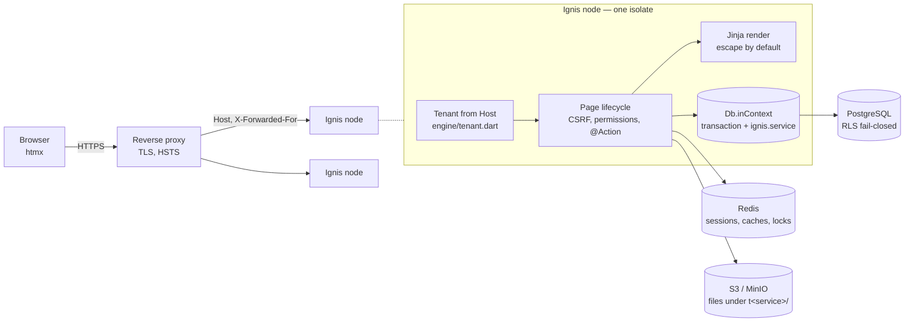

# Ignis — a bare multi-tenant web engine for Dart

[](LICENSE)
[](https://buymeacoffee.com/cygan)

Ignis is a Dart package for server-rendered back-office applications: pages and entities declared with
annotations, Jinja templates, an `/admin` panel with accounts and permissions, and many services
(tenants) under their own domains in a single install. It ships no domain modules — everything beyond
the core is added by an **application** that depends on `ignis`.

## Why

- **One install, many tenants, hard isolation.** The tenant comes from the `Host` header, and
  PostgreSQL Row-Level Security is fail-closed underneath the application filter, so a forgotten
  `WHERE service = …` returns nothing instead of someone else's data.
- **Boring server-side HTML.** Pages render on the server and htmx swaps fragments. There is no SPA
  build, no client-side state and no inline JavaScript, so a strict script CSP is possible (today a `<meta>` in the
  panel layouts; a response header is the proxy's job).
- **Annotations instead of glue.** `@Page` and `@Entity` give you routes, menu entries, permissions,
  tables and RLS policies. Nothing has to be registered by hand.

## Features

- Routing and page lifecycle (`doBeforeProcess → isAbleToSee → processData → @Action (POST only) →
  insertData → render`), CSRF, CORS, a request deadline and secure default headers
- Jinja rendering with escaping by default (`Html(...)` for trusted markup) and versioned static assets
- ORM with auto-schema (`update | validate | none`) and RLS policies for every table with a `service` column
- Sessions in Redis, so every node behind the load balancer sees the same state
- Login with TOTP second factor (RFC 6238), forced password change and rate limits
- Accounts, permission packages, grants and denials, with a panel to manage them
- Front-end customer accounts (password, reset token, separate session)
- Audit log (`audit_log`) for every panel action, including its outcome, logins and 2FA
- File storage on S3/MinIO, with metadata and folders in PostgreSQL
- Settings registry with AES-GCM-encrypted secrets
- Translations, time zones, CSV, paging, sorting and date-range components
- JWT RS256, HMAC-signed links, trusted-proxy client address
- `/health` health check and graceful shutdown

Ignis uses `dart:mirrors`, so it runs on the Dart VM in JIT mode (`dart run`), not AOT.

## Quick start

Requirements: Dart SDK ≥ 3.6, PostgreSQL ≥ 13 and Redis reachable from the node.

```bash
git clone https://github.com/PawelSzymanski89/ignis.git && cd ignis
dart pub get

createdb ignis                     # an empty database; tables appear on first start

# every secret generated, the file readable only by you (it holds the database password and the key)
umask 077
cat > .env <<EOF
IGNIS_KEY=$(openssl rand -hex 32)
IGNIS_DOMAINS=localhost
IGNIS_DB_HOST=127.0.0.1
IGNIS_DB_PASS=$(openssl rand -base64 18)
IGNIS_REDIS_HOST=127.0.0.1
IGNIS_ADMIN_PASS=$(openssl rand -base64 18)
# behind a reverse proxy: its address (IP/CIDR). Unset = X-Forwarded-For ignored, every client looks
# like the proxy — login limits then lock out everyone at once, and the log records only the proxy IP
IGNIS_TRUSTED_PROXIES=127.0.0.1
EOF
chmod 600 .env

set -a && . ./.env && set +a
dart run bin/server.dart           # "Ignis listening on 127.0.0.1:8080" when ready
```

Set the same `IGNIS_DB_PASS` on the PostgreSQL role (`ALTER ROLE ignis PASSWORD '…'`). Open
`http://admin.localhost:8080/admin/login` (browsers resolve `*.localhost` to the loopback and treat it as a
secure context, so the `__Host-` cookies work without TLS) and log in as `admin` with the `IGNIS_ADMIN_PASS`
from `.env`. The panel will require a new password straight away. Without `IGNIS_ADMIN_PASS`, a random
password is printed once to the console; a supplied one is never printed.

The repository ships templates, the engine's own scripts (`/assets/ignis/`) and brand files, but not the
admin theme's CSS/JS libraries (Bootstrap, htmx, icons). Point `IGNIS_ASSETS` at a directory with them;
(`libs/htmx/htmx.min.js`, `libs/bootstrap/…`); without them the panel renders, but unstyled and without htmx
navigation.

Session cookies are `__Host-`-prefixed and `Secure`, so outside `localhost` browsers send them only over HTTPS. Put the node
behind a TLS reverse proxy (see [SECURITY.md](SECURITY.md#sample-reverse-proxy-configuration)).

### Your own application

```dart
// bin/server.dart of your app
import 'package:ignis/ignis.dart';
// ignore: unused_import
import 'package:ignis/entities.dart';
// ignore: unused_import
import 'package:ignis/pages.dart';
// ignore: unused_import
import 'package:my_app/my_app.dart';   // barrel with your pages and entities

Future<void> main() => Ignis.start(
      brand: 'MyApp',
      templates: ['templates'],         // searched before the package templates
      appAssets: ['web/assets'],        // your /assets/…, before IGNIS_ASSETS
      permissions: [('projects.view', 'View projects')],
      settingsSections: [
        Section('api', 'API', 'fe fe-key', 'Integration keys.', [Field('api_token', 'Token', type: FieldType.password)]),
      ],
      languages: ['en', 'pl'],          // i18n/<language>.json; the first is the default
      seed: seedMyApp,                  // runs after the core seed
      tasks: [Queue.start],             // background jobs started after boot
    );
```

- **Pages** extend `PageEngine` / `AdminPage` and carry `@Page(route, template:, requires:, label:,
  group:, order:)`. `@Page(api: true)` is a JSON route without CSRF. `@Page(methods: ['POST'])`
  returns 405 for other methods. `@Page(maxBody:)` is the only way a route accepts multipart.
- **Entities** use `@Entity('table', pk:, unique:)`. Tables and columns are created at start-up, but
  columns are never dropped and their types are never changed.
- `dart:mirrors` only sees classes reachable from `main`, so **your barrel must be imported in
  `bin/server.dart`**.
- Templates and static files are overridden by a file with the same name in your directories.

## Architecture



Each request resolves its tenant from `Host` exactly once. It then runs inside a database transaction
where `ignis.service` is set locally, so the RLS policies see the right tenant. The response goes out
only after that transaction commits and its connection has gone back to the pool.

## Configuration

All configuration comes from environment variables read by the engine.

| Variable | Default | Meaning |
|---|---|---|
| `IGNIS_KEY` | **required** | 64 hex chars; AES-GCM key for secrets and HMAC key for signatures. The node refuses to start without it |
| `IGNIS_DOMAINS` | **required** | comma-separated system domains; `admin.<domain>` is the platform panel |
| `IGNIS_DB_HOST` | **required** | PostgreSQL host |
| `IGNIS_DB_PASS` | **required** | PostgreSQL password |
| `IGNIS_DB_PORT` | `5432` | PostgreSQL port |
| `IGNIS_DB_NAME` | `ignis` | database name |
| `IGNIS_DB_USER` | `ignis` | database role — a plain role owning the tables; a superuser or `BYPASSRLS` role is refused at start-up (RLS would not apply) |
| `IGNIS_DB_POOL` | `16` | connection pool size |
| `IGNIS_DB_SSL` | `disable` | `verify-full` = TLS with certificate and host verification, `require` = TLS without verification; other values abort start-up |
| `IGNIS_REDIS_HOST` | **required** | Redis host |
| `IGNIS_REDIS_PORT` | `6379` | Redis port |
| `IGNIS_REDIS_PASS` | — | Redis password |
| `IGNIS_REDIS_TLS` | — | `1` = TLS to Redis, verified against system CAs |
| `IGNIS_PORT` | `8080` | HTTP listen port |
| `IGNIS_NODE` | `node` | node name in logs, locks and the audit log |
| `IGNIS_SCHEMA` | `update` | `update` creates tables and columns, `validate` and `none` only check |
| `IGNIS_ASSETS` | `web/assets` | directory with the theme's static files (`/assets/…`) |
| `IGNIS_TRUSTED_PROXIES` | — | IPs/CIDRs whose `X-Forwarded-For` is trusted |
| `IGNIS_TIMEOUT_S` | `120` | whole-request deadline in seconds |
| `IGNIS_SHORT_TIMEOUT_S` | `15` | deadline for routes without `maxBody` (plain forms) |
| `IGNIS_UPLOAD_BUDGET_MB` | `64` | total size of multipart bodies buffered at once |
| `IGNIS_BCRYPT_THREADS` | CPU count | concurrent bcrypt isolates |
| `IGNIS_BIND` | `127.0.0.1` | listen address (`0.0.0.0` or a private address when the proxy is on another host) |
| `IGNIS_HSTS` | — | `1` makes the node send `Strict-Transport-Security` |
| `IGNIS_ADMIN_PASS` | random | password of the `admin` account created on the first start (min. 10 characters, else the seed aborts) |
| `IGNIS_S3_HOST` | — | S3/MinIO host; without it file storage is disabled |
| `IGNIS_S3_PORT` | `9000` | S3 port |
| `IGNIS_S3_KEY` / `IGNIS_S3_SECRET` | required with `IGNIS_S3_HOST` | S3 credentials |
| `IGNIS_S3_BUCKET` | `ignis` | bucket name |
| `IGNIS_S3_SSL` | — | `1` = HTTPS to S3 with certificate verification |
| `IGNIS_S3_TIMEOUT_S` | `60` | deadline of one transfer to S3 |

### Console tools (`bin/`)

| Tool | Purpose |
|---|---|
| `server.dart` | the core node |
| `account.dart list \| disable-2fa <login> \| password <login>` | emergency 2FA removal or password reset. The password is read from stdin and the action is written to the audit log |
| `purge.dart list \| delete <slug>…` | removes a service with its rows, S3 objects, sessions and caches. Asks for confirmation and writes to the audit log |
| `smoke_panel.dart <panel-url> <login>` | logs in and opens every panel route. The password is read from stdin; any 5xx makes it exit with 1 |

## Security

The threat model, tenant isolation (RLS), authentication, CSP, secrets, network edge and known gaps are
described in [SECURITY.md](SECURITY.md). Please report vulnerabilities privately through
[GitHub Security Advisories](https://github.com/PawelSzymanski89/ignis/security/advisories/new).

## Testing

```bash
dart analyze
for t in test/*_test.dart; do dart run "$t" || echo "FAIL $t"; done
```

Tests that need PostgreSQL and Redis (RLS on a role without `BYPASSRLS`, seed, audit log) run on
throw-away instances with:

```bash
tool/pg_test.sh
```

Without `IGNIS_DB_HOST` these tests skip themselves. Engineering rules are in [QUALITY.md](QUALITY.md).

## Status

Version **0.1.0**. It is the first public release, extracted from a production multi-tenant panel. The
API (`Ignis.start`, `@Page`, `@Entity`) may still change before 1.0. Identifiers, the database schema
and the default UI language are English; a Polish translation of the panel ships in `i18n/pl.json`.

## License

MIT — see [LICENSE](LICENSE).

## Support

If Ignis saves you time, you can support its development:

[](https://buymeacoffee.com/cygan)
