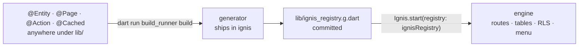
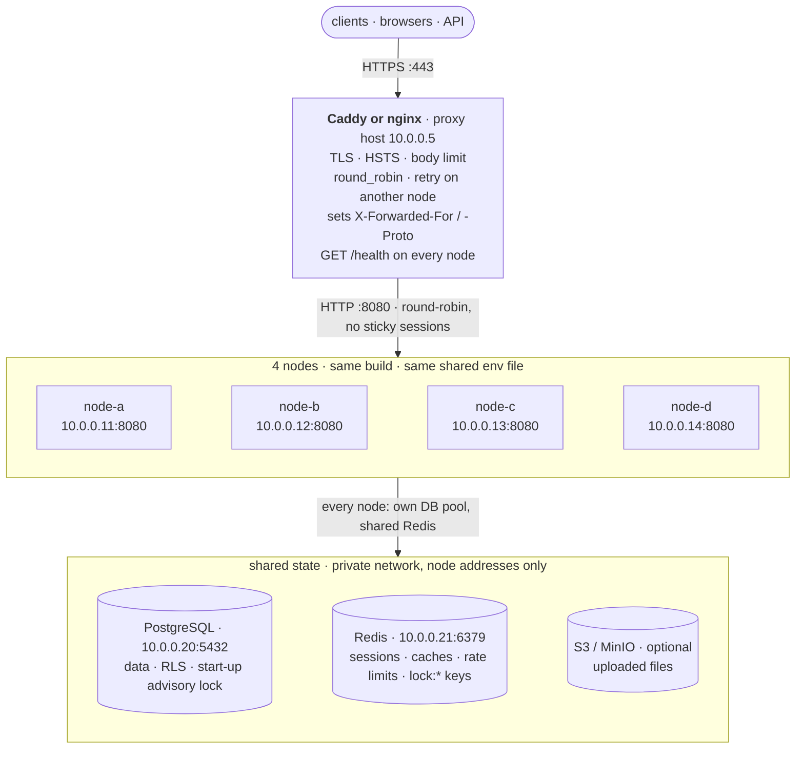
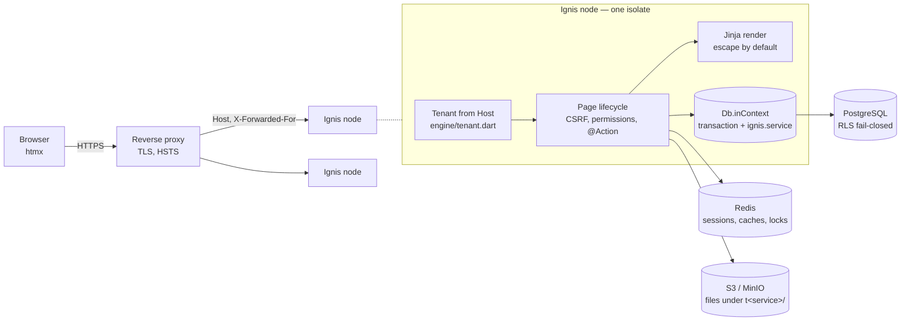

<div align="center">

<picture>
  <source media="(prefers-color-scheme: dark)" srcset="assets/banner.svg">
  <source media="(prefers-color-scheme: light)" srcset="assets/banner-light.svg">
  
</picture>

<h3>Server-rendered, multi-tenant back-office apps in Dart — isolated by PostgreSQL row-level security, declared with annotations.</h3>

[](https://github.com/PawelSzymanski89/ignis/releases)
[](LICENSE)
[](https://dart.dev)
[](https://www.postgresql.org)
[](https://redis.io)
[](#contributing)
[](https://buymeacoffee.com/cygan)

<p>
  <a href="#quick-start"><b>Quick start</b></a> ·
  <a href="#features"><b>Features</b></a> ·
  <a href="SECURITY.md"><b>Docs</b></a> ·
  <a href="#security"><b>Security</b></a> ·
  <a href="CHANGELOG.md"><b>Changelog</b></a>
</p>

</div>

---

Ignis is a Dart package for **server-rendered back-office applications**: pages and entities declared with
annotations, Jinja templates, an `/admin` panel with accounts and permissions, and many services (tenants)
under their own domains in a single install. It ships no domain modules — everything beyond the core is
added by an **application** that depends on `ignis`. The same app runs under `dart run` and as **one
self-contained native binary** (`dart compile exe`).

## At a glance

One entity and one panel page — a table with an RLS policy, a route, a menu entry, a permission check and
a POST action. Drop it anywhere under `lib/` — the generator that ships in `ignis` picks it up on the next
build:

```dart
import 'package:ignis/ignis.dart';

@Entity('notes')
class Note {
  int? id;            // primary key — bigserial, assigned by the database
  int service = 0;    // a `service` column ⇒ an RLS policy is created for this table
  String text = '';
}

@Page('/admin/notes',
    template: 'notes.html',   // your templates/notes.html
    requires: 'notes.view',   // declared in Ignis.start(permissions: [...])
    label: 'Notes',           // menu entry, shown only to accounts with `requires`
    icon: 'fe fe-file-text',
    group: 'Content',
    order: 10)
class NotesPage extends AdminPage {
  // runs on POST with triggerAction=add (CSRF already checked by the engine)
  @Action('add')
  Future<bool> add() async {
    if (!can('notes.edit')) return missingPermission('notes.edit');
    await Orm.save(Note()
      ..service = context.service
      ..text = get('text') ?? '');
    return back('/admin/notes', message: 'Saved');
  }

  @override
  Future<void> insertData() async {
    await sharedData(); // menu, signed-in account, flash message
    put('notes', await Orm.pick<Note>(
        'SELECT * FROM notes WHERE service = @s ORDER BY id', {'s': context.service}));
  }
}
```

Every string in the model is HTML-escaped before it reaches the template; `Html(...)` marks trusted markup.

## Table of contents

- [Why Ignis](#why-ignis)
- [Features](#features)
- [Quick start](#quick-start)
- [How it works](#how-it-works)
- [Development loop](#development-loop)
- [Deployment and AOT](#deployment-and-aot)
- [Running a cluster](#-running-a-cluster)
- [Templates](#templates)
- [Why no `dart:mirrors`](#why-no-dartmirrors)
- [Caching](#-caching)
- [Architecture](#architecture)
- [Configuration](#configuration)
- [Content-Security-Policy](#content-security-policy)
- [Testing](#testing)
- [Status](#status)
- [Roadmap](#roadmap)
- [Contributing](#contributing)
- [Security](#security)
- [License](#license)
- [Support](#support)

## Why Ignis

<table>
<tr>
<td width="50%" valign="top">

### 🏢 One install, many tenants

The tenant comes from the `Host` header, and PostgreSQL **Row-Level Security is fail-closed** underneath the
application filter: a forgotten `WHERE service = …` returns nothing instead of someone else's data. The node
refuses to start on a superuser or `BYPASSRLS` role.

</td>
<td width="50%" valign="top">

### 🧾 Boring server-side HTML

Pages render on the server and htmx swaps fragments. No SPA build, no client-side state, no inline
JavaScript — so the script policy can be strict: `script-src 'self'`, sent as a **`Content-Security-Policy`
header on every HTML response** and repeated as a `<meta>` in the package layouts.

</td>
</tr>
<tr>
<td width="50%" valign="top">

### 🏷️ Annotations, not glue

`@Page` and `@Entity` give you routes, menu entries, permissions, tables and RLS policies. Nothing is
registered by hand: the generator that ships in `ignis` finds every annotated class under `lib/` and writes a
plain Dart registry — so the same app runs under `dart run` and as one native binary.

</td>
<td width="50%" valign="top">

### 🔐 Secure by default

CSRF on every unsafe method, `__Host-` cookies, login rate limits, AES-GCM-encrypted secrets, an audit log
of every panel action, a request deadline and hardened response headers are on without opting in; a TOTP
second factor is built into the panel.

</td>
</tr>
</table>

## Features

| | Area | What you get |
|---|---|---|
| 🧭 | **Routing** | Page lifecycle `doBeforeProcess → isAbleToSee → processData → @Action (POST only) → insertData → render`; route parameters (`/v1/items/{id}`); per-route methods, body limits and CORS; CSRF, a request deadline and secure default headers |
| 🎨 | **Rendering** | Jinja templates with escaping by default (`Html(...)` for trusted markup), app templates override package ones, versioned static assets (`?v=`), gzip + ETag + 304 for `/assets/` |
| 🗄️ | **Data** | ORM with auto-schema (`update \| validate \| none`) and RLS policies for every table with a `service` column; settings registry with AES-GCM-encrypted secrets; CSV, paging, sorting and date-range components |
| 🔑 | **Auth** | Login with TOTP second factor (RFC 6238), forced password change and rate limits; accounts, permission packages, grants and denials with a panel to manage them; front-end customer accounts (password, reset token, separate session); JWT RS256 and HMAC-signed links |
| 🏢 | **Tenancy** | Tenant resolved from `Host` once per request; a per-request transaction with `ignis.service` set locally; sessions in Redis, so every node behind the load balancer sees the same state |
| 📦 | **Storage** | File storage on S3/MinIO, with metadata and folders in PostgreSQL |
| ⚡ | **Caching** | `@Cached` entity cache in Redis shared by every node; permission cache invalidated after commit; settings cache; in-memory domain map; immutable versioned assets and ETag/304 — [details](#-caching) |
| 🚀 | **Deploy** | `dart run` while developing, one self-contained binary from `dart compile exe` in production; the generated registry is committed, so a deploy needs no build step |
| 🛠️ | **Ops** | Audit log (`audit_log`) for every panel action including its outcome, logins and 2FA; `/health` health check; graceful shutdown; trusted-proxy client address; translations and time zones; console tools for emergencies |

> [!NOTE]
> **New in 0.3.0:** pages and entities come from a registry generated at build time
> (`lib/ignis_registry.g.dart`). One dev dependency (`build_runner`), one command, one line in `Ignis.start` —
> and the node compiles to a native binary. Upgrading from 0.2.x takes three steps, listed in the
> [changelog](CHANGELOG.md); the reasons are in [Why no `dart:mirrors`](#why-no-dartmirrors).

## Quick start

**Requirements:** Dart SDK ≥ 3.11, PostgreSQL ≥ 13 and Redis reachable from the node.

**1. Create the app** and add Ignis. `build_runner` is the only dev dependency — the registry generator ships
inside `ignis`:

```yaml
# pubspec.yaml
name: my_app
environment:
  sdk: ^3.11.0
dependencies:
  ignis:
    git: {url: https://github.com/PawelSzymanski89/ignis.git, ref: v0.4.3}
dev_dependencies:
  build_runner: ^2.4.0
```

**2. Declare a page.** Save the `Note` / `NotesPage` code from [At a glance](#at-a-glance) as `lib/notes.dart`,
and its template as `templates/notes.html`:

```html

Notes

<ul><li>{{ n.text }}</li></ul>
<form method="post">
  <input type="hidden" name="csrf" value="{{ csrf }}">
  <input name="text"> <button name="triggerAction" value="add">Add</button>
</form>

```

**3. Generate the registry** — and commit the file it writes:

```bash
dart pub get
dart run build_runner build      # writes lib/ignis_registry.g.dart
```

**4. Pass it to the engine** — the one line Ignis cannot write for you:

```dart
// bin/server.dart
import 'package:ignis/ignis.dart';
import 'package:my_app/ignis_registry.g.dart'; // generated by `dart run build_runner build`

Future<void> main() => Ignis.start(
      registry: ignisRegistry, // your pages and entities; the core ones are merged in
      brand: 'MyApp',
      templates: ['templates'],
      permissions: [('notes.view', 'View notes'), ('notes.edit', 'Edit notes')],
    );
```

**5. Start it:**

```bash
createdb ignis                     # an empty database; tables appear on first start

# every secret generated, the file readable only by you (it holds the database password and the key)
umask 077
cat > .env <<EOF
IGNIS_KEY=$(openssl rand -hex 32)
IGNIS_DOMAINS=localhost
IGNIS_DB_HOST=127.0.0.1
IGNIS_DB_PASS=$(openssl rand -base64 18)
IGNIS_REDIS_HOST=127.0.0.1
IGNIS_ADMIN_PASS=$(openssl rand -base64 18)
# required: behind a reverse proxy its address (IP/CIDR), `none` when clients connect directly. A wrong
# value makes every client look like the proxy — login limits lock out everyone, the log sees one IP
IGNIS_TRUSTED_PROXIES=127.0.0.1
EOF
chmod 600 .env

set -a && . ./.env && set +a
dart run bin/server.dart           # "Ignis listening on 127.0.0.1:8080" when ready
```

Then:

1. Set the same `IGNIS_DB_PASS` on the PostgreSQL role (`ALTER ROLE ignis PASSWORD '…'`).
2. Open `http://admin.localhost:8080/admin/login`. Browsers resolve `*.localhost` to the loopback and treat
   it as a secure context, so the `__Host-` cookies work without TLS.
3. Log in as `admin` with the `IGNIS_ADMIN_PASS` from `.env`. The panel will require a new password straight
   away. Without `IGNIS_ADMIN_PASS`, a random password is printed once to the console; a supplied one is
   never printed. **Notes** is in the menu under *Content*.

> [!TIP]
> Just want to look at the panel first? The repository itself is a runnable node with the core pages:
> `git clone https://github.com/PawelSzymanski89/ignis.git && cd ignis && dart pub get`, then step 5.

> [!IMPORTANT]
> The repository ships templates, the engine's own scripts (`/assets/ignis/`) and brand files, but **not** the
> admin theme's CSS/JS libraries (Bootstrap, htmx, icons). Point `IGNIS_ASSETS` at a directory with them
> (`libs/htmx/htmx.min.js`, `libs/bootstrap/…`); without them the panel renders, but unstyled and without
> htmx navigation.

Session cookies are `__Host-`-prefixed and `Secure`, so outside `localhost` browsers send them only over
HTTPS. Put the node behind a TLS reverse proxy (see
[SECURITY.md](SECURITY.md#sample-reverse-proxy-configuration)).

Everything else `Ignis.start` takes:

```dart
Future<void> main() => Ignis.start(
      registry: ignisRegistry,          // core pages and entities are added to it
      brand: 'MyApp',
      templates: ['templates'],         // searched before the package templates
      appAssets: ['web/assets'],        // your /assets/…, before IGNIS_ASSETS
      permissions: [('projects.view', 'View projects')],
      settingsSections: [
        Section('api', 'API', 'fe fe-key', 'Integration keys.', [Field('api_token', 'Token', type: FieldType.password)]),
      ],
      languages: ['en', 'pl'],          // i18n/<language>.json; the first is the default
      seed: seedMyApp,                  // runs after the core seed
      tasks: [Queue.start],             // background jobs started after boot
    );
```

## How it works



1. **Annotations.** `@Entity('table', pk:, unique:)` maps a class to a table; `@Cached` adds a shared Redis
   copy; `@Page(route, template:, requires:, label:, group:, order:)` makes a route and a menu entry;
   `@Action('name')` marks a method called on POST with `triggerAction=name`.
2. **Generator.** `ignis` carries a build_runner builder (`ignis|registry`) that applies itself to every
   package depending on `ignis` — no `build.yaml`, no stub file in your app. It reads **every `.dart` file under
   `lib/`**, so a new page or entity needs no import or barrel; `bin/` and `test/` are not scanned.
3. **Registry.** The output, `lib/ignis_registry.g.dart`, is ordinary Dart: constructor tear-offs, getter and
   setter closures per field, `@Action` calls, constant column defaults and per-class template getters.
   Commit it — `dart run` and `dart compile exe` need nothing else.
4. **Engine.** `Ignis.start(registry: ignisRegistry)` merges your registry with the core one and builds routes,
   the menu, tables, columns and RLS policies from it at start-up. Tables and columns are created, but columns
   are never dropped and their types are never changed.

The generator stops the build with file, line and class when:

- a page or entity has no **unnamed constructor without required parameters** (the engine calls it);
- a `@Page` class does not extend `PageEngine` (or `AdminPage` / `CustomerPage`), an `@Action` method is
  private or takes required parameters, or two entities share a class name.

It warns (and the build goes on) when a column **default is not constant** — `String status = 'new';` is
fine, a computed one gets no column default — and when a class or field is private (it is skipped).

`@Page(api: true)` is a JSON route without CSRF, so it must not authenticate by cookie: on an `AdminPage` /
`CustomerPage` subclass it stops the node at start-up, and it never receives the session, customer-session or CSRF
cookie nor the `Cookie` header. `@Page(methods: ['POST'])` returns 405 for other methods.
`@Page(maxBody:)` is the only way a route accepts multipart.

**Guard rails at start-up:**

- **No registry → no start.** Without `registry:` the node stops with a `StateError` that lists the three
  steps: `build_runner` in `dev_dependencies`, `dart run build_runner build` (or `watch`), and the
  `registry: ignisRegistry` line.
- **Stale registry → one warning, the start goes on.** The registry carries a fingerprint: a sha256 over the
  sorted paths and contents of every `lib/**.dart` (except the generated file). Under `dart run` Ignis
  recomputes it from the sources on disk; if anything under `lib/` was added, removed or edited since the
  last build, it prints **one** warning with the build / watch commands and runs on the registry as
  generated. An AOT binary has no sources, so it skips the check.

## Development loop

```bash
dart run build_runner watch      # leave it running: the registry is rebuilt after every save
dart run bin/server.dart         # restart the node to pick up changes
```

Forgot `watch`? The stale-registry warning at start-up says so, with the command to run.

## Deployment and AOT

```bash
dart compile exe bin/server.dart -o server
```

- The registry is committed, so the build machine and CI need **no code generation** — `dart pub get` and
  `dart compile exe` are enough. To fail CI when someone forgot to regenerate:

  ```bash
  dart run build_runner build && git diff --exit-code -- lib/ignis_registry.g.dart
  ```

- The generator's dependencies (`analyzer`, `build`, `source_gen`) are build-time only:
  `package:ignis/ignis.dart` never imports them, so they are not in the binary.
- A compiled binary has no package config, so set `IGNIS_PACKAGE_ROOT` to a copy of the ignis package
  directory (its `templates/`, `i18n/`, `web/`). Your own `templates` / `appAssets` paths resolve against the
  working directory as before.
- `tool/aot_smoke.sh` compiles `bin/server.dart` and checks the binary against `dart run` on a fresh
  database: `/health`, sign-in, panel pages, a CRUD round-trip, identical HTML.

## 🧩 Running a cluster

Several nodes behind one load balancer need no extra component — only consistent configuration.

### 🧭 Topology

- **N nodes**, all from the same build of the same app version (same `lib/ignis_registry.g.dart`, templates and
  assets).
- **One PostgreSQL, one Redis** (and optionally one S3/MinIO bucket) shared by every node.
- **A reverse proxy** in front, terminating TLS and balancing round-robin. Sticky sessions are not needed:
  sessions, permissions, settings and entity copies live in Redis — see *Why it scales* under
  [Caching](#-caching).

Four nodes, with the addresses used in the examples below:



No node talks to another: everything they share goes through PostgreSQL and Redis, so any node can serve any
request, and a node can be added or removed by changing only the proxy upstreams. Each node has its own
`IGNIS_NODE` and `IGNIS_BIND` ([below](#-environment-per-node)) and its own pool of `IGNIS_DB_POOL` connections.

```bash
# the same on every node — one file, distributed with the build (mode 600)
IGNIS_KEY=…                       # one key for the whole cluster
IGNIS_DOMAINS=example.com
IGNIS_TRUSTED_PROXIES=10.0.0.5    # the load balancer
IGNIS_DB_HOST=10.0.0.20
IGNIS_DB_USER=ignis_rt            # runtime role, see "Schema with many nodes"
IGNIS_DB_PASS=…
IGNIS_SCHEMA=validate
IGNIS_REQUIRE_RUNTIME_ROLE=1
IGNIS_REDIS_HOST=10.0.0.21
IGNIS_REDIS_PASS=…

# different on every node
IGNIS_NODE=node-a
IGNIS_BIND=10.0.0.11              # the node's private address, reachable from the proxy
```

### 🔑 Environment per node

**Must be identical:** `IGNIS_KEY`, `IGNIS_KEY_PREVIOUS`, `IGNIS_DOMAINS`, `IGNIS_DB_HOST` / `_PORT` / `_NAME` /
`_SSL`, `IGNIS_REDIS_*`, `IGNIS_S3_*`, `IGNIS_TRUSTED_PROXIES`, `IGNIS_HSTS`, and in practice the limits
(`IGNIS_TIMEOUT_S`, `IGNIS_MAX_INFLIGHT`, …) so that nodes behave alike. `IGNIS_DB_USER` / `IGNIS_DB_PASS` /
`IGNIS_SCHEMA` differ only between the migrating step and the serving nodes ([below](#-schema-with-many-nodes)).

**A different `IGNIS_KEY` on one node** is not detected at start-up. Sessions keep working (Redis keys are
token digests, not keyed), but everything derived from the key breaks across nodes: encrypted settings
secrets and TOTP seeds read as empty on the odd node (so its sign-ins with 2FA are denied, and a secret saved
there is unreadable elsewhere), and signed flash messages from one node silently disappear on another.
Rotating the key is the same: set the new `IGNIS_KEY` and the old one as `IGNIS_KEY_PREVIOUS` on **every**
node, restart all of them, run `bin/rekey.dart` once, then remove `IGNIS_KEY_PREVIOUS` everywhere and restart
again.

**Must be unique:**

- `IGNIS_NODE` — the node name in the start-up log, the owner value of background-job locks in Redis
  (`lock:audit_log`), the `"node"` field of `/health` (and its `health:<node>` key) and the panel footer. It is **not** stored in the
  audit log. On SIGTERM a node deletes the `lock:*` keys that carry its name, so two nodes with the same name
  release each other's locks. Unset, it is `node` for locks and `unknown` in `/health` and the panel, and the
  node warns at start-up.
- `IGNIS_BIND` — the default `127.0.0.1` is unreachable from a proxy on another host; bind to the node's
  private address (or `0.0.0.0` behind a firewall).

Set `IGNIS_TRUSTED_PROXIES` to the load balancer's address(es) on **every** node. A wrong value makes every
client look like the proxy — see the comment in the [Quick start](#quick-start) `.env` and
[SECURITY.md](SECURITY.md#sample-reverse-proxy-configuration).

### 🐘 PostgreSQL and Redis over the network

- Listen on a private address only (`listen_addresses`, Redis `bind`), and allow only the node addresses
  (`pg_hba.conf` entries per node, a firewall or Redis ACL in front of Redis).
- Give Redis a password (`requirepass` / ACL user → `IGNIS_REDIS_PASS`). Without one a remote Redis is
  warned about: `Ignis WARNING: Redis at … is outside loopback and IGNIS_REDIS_PASS is empty — anyone on the
  network can read sessions; set a password.`
- Every backend host outside loopback with TLS off gives
  `Ignis WARNING: PostgreSQL at … is outside loopback and TLS is off — set IGNIS_DB_SSL=verify-full, unless the
  network is private and trusted.` (likewise Redis → `IGNIS_REDIS_TLS=1`, S3 → `IGNIS_S3_SSL=1`). On a private
  network that only the cluster can reach, the warning can stay. When the traffic crosses anything shared
  (another data centre, a cloud VPC with other tenants, the internet), turn TLS on: `IGNIS_DB_SSL=verify-full`
  (`require` encrypts without checking the certificate and is warned about too), `IGNIS_REDIS_TLS=1`.
- The pool is per node: `N × IGNIS_DB_POOL` (16 by default) must fit in PostgreSQL's `max_connections`.

### 🧱 Schema with many nodes

Nodes that start at the same time do not race: schema sync and the core seed (including the first `admin`
account) run under one PostgreSQL advisory lock. The others log
`Ignis: waiting for start-up lock (another node is migrating or seeding)` and give up after 5 minutes. The
app's own `seed:` callback runs **after** that lock, on every node — keep it idempotent (`ON CONFLICT DO
NOTHING`).

Recommended split ([SECURITY.md → Runtime database role](SECURITY.md#runtime-database-role)):

- **Migrate** in a separate deploy step (or on one node) on the owner role with `IGNIS_SCHEMA=update`, before
  the serving nodes get the new build.
- **Serve** on the runtime role with `IGNIS_SCHEMA=validate` and `IGNIS_REQUIRE_RUNTIME_ROLE=1`. A serving node
  whose tables or columns are missing exits at start-up — the order above matters.

Auto-schema only **adds** tables, columns (with `NOT NULL DEFAULT` from a constant field default) and unique
constraints, so old nodes keep working against a migrated database — that is what makes a rolling deploy
possible. It never drops or retypes: a removed or renamed field leaves its column behind with
`columns without a class field: … (kept — drop them by hand if unneeded)`. Drop such columns by hand, only
after every node runs the new build.

### 🔄 Rolling deploy

1. Migrate (above), then replace the nodes **one at a time**.
2. Stop a node with **SIGTERM** (or SIGINT): it stops accepting connections, waits up to **20 s** for requests
   in flight, cuts the rest, releases its `lock:*` keys and closes the pool. Give the process manager more
   than 20 s before it sends SIGKILL (Docker's default is 10 s).
3. Start the new node and wait for `/health` to return 200 before moving on.

`/health` returns `200` with `{"node", "healthy", "database", "redis", "storage"}`, or `503` when PostgreSQL or
Redis does not answer within 2 s (storage is reported but does not affect the status). It answers only
loopback and `IGNIS_TRUSTED_PROXIES` without `X-Forwarded-For`; anyone else gets 404. Because the database and
Redis are shared, losing one of them fails every node's probe at once and the proxy drops the whole pool —
deliberately.

During the switch both builds serve traffic, so keep the registry committed and identical on every node of
one build (`dart run build_runner build`, then the CI check from [Deployment and AOT](#deployment-and-aot)).
Under `dart run` a stale registry is reported at start-up with
`Ignis WARNING: lib/ignis_registry.g.dart is out of date …`; an AOT binary skips that check. Assets are safe
across builds: a node asked for a `?v=` that is not the digest of its own copy of the file answers `no-cache`,
not `immutable`.

### 🌐 Domains and caches across nodes

Everything cached in Redis is shared and invalidated once for all nodes. The exception is the **domain map**,
held in each node's memory and re-read every 30 s (`Tenants.refreshing`). `Tenants.refresh()` affects only the
node it runs on, so after a domain or service change the other nodes need up to 30 s: a new domain may answer
404 there, a disabled service is still served.

### 🔒 One job per cluster

`Ignis.start(tasks: …)` runs on **every** node. Work that must happen once per cluster needs a Redis lock.
The engine's own audit-log retention shows the pattern: every node runs the daily timer, but only the one
that wins `Redis.setNxEx('lock:audit_log', <IGNIS_NODE>, 3600)` deletes old entries; the others skip that
round. A `lock:` key carrying the node name is also released when that node shuts down.

### 🚦 Proxy for several nodes

Caddy passes `Host` through unchanged and sets `X-Forwarded-For` and `X-Forwarded-Proto` by default (ignoring
the client's own values), which is all the node needs:

```caddy
admin.example.com, demo.example.com {
	header Strict-Transport-Security "max-age=31536000; includeSubDomains"
	request_body {
		max_size 16MiB
	}
	reverse_proxy 10.0.0.11:8080 10.0.0.12:8080 10.0.0.13:8080 10.0.0.14:8080 {
		lb_policy round_robin
		lb_try_duration 5s     # retry on another node: GETs, and any request that could not connect
		fail_duration 30s      # passive checks: a failing node is skipped for 30 s
		health_uri /health     # active checks, sent without X-Forwarded-For
		health_interval 10s
		health_timeout 3s
	}
}
```

nginx: extend the [sample server block](SECURITY.md#sample-reverse-proxy-configuration) with an upstream.
Open-source nginx has only passive checks, so poll `/health` from a monitor on the proxy host as well:

```nginx
upstream ignis {
    server 10.0.0.11:8080 max_fails=1 fail_timeout=30s;
    server 10.0.0.12:8080 max_fails=1 fail_timeout=30s;
    server 10.0.0.13:8080 max_fails=1 fail_timeout=30s;
    server 10.0.0.14:8080 max_fails=1 fail_timeout=30s;
}

# in the server block — headers exactly as in SECURITY.md
location / {
    proxy_pass http://ignis;
    proxy_next_upstream error timeout http_502 http_503;   # a POST is retried only if it never reached a node
    proxy_set_header Host              $host;
    proxy_set_header X-Forwarded-For   $remote_addr;
    proxy_set_header X-Forwarded-Proto $scheme;
}
```

Send HSTS from the proxy (as above) or set `IGNIS_HSTS=1` on every node.

### ✅ Before adding a node

- [ ] Same build as the rest: the same commit, `lib/ignis_registry.g.dart`, templates and assets.
- [ ] The shared env file is byte-identical (`sha256sum` it on every node) — above all `IGNIS_KEY`.
- [ ] A unique `IGNIS_NODE`, and `IGNIS_BIND` set to the node's private address.
- [ ] The node's address allowed in `pg_hba.conf` and the Redis firewall/ACL; the pool still fits in
      `max_connections`.
- [ ] Serving on the runtime role with `IGNIS_SCHEMA=validate` and `IGNIS_REQUIRE_RUNTIME_ROLE=1`.
- [ ] Graceful stop: SIGTERM with more than 20 s before SIGKILL.
- [ ] Added to the proxy upstreams only after its `/health` returns 200.

**Check the cluster:**

- From the proxy host (an `IGNIS_TRUSTED_PROXIES` address), `curl -s http://10.0.0.11:8080/health` for each
  node: `200`, `"healthy": true` and that node's own `"node"`. From anywhere else the probe answers 404.
- Sign in through the proxy and reload the page a few times (a full reload): the node name in the panel footer
  changes (round-robin) while you stay signed in — the session from node A is valid on node B.

### 🍎 Packaging from macOS: no `._*` files

An archive made on macOS can carry AppleDouble files (`lib/._notes.dart` next to `lib/notes.dart`). Under
`dart run` the stale-registry check reads every `lib/**.dart` file as UTF-8, so such a file stops the start with
`FileSystemException: Failed to decode data using encoding 'utf-8'` — under a restart policy, a restart loop.
Build archives without them (`COPYFILE_DISABLE=1 tar -czf app.tgz …`) or remove them on the server
(`find . -name '._*' -delete`). An AOT binary does not read `lib/`.

## Templates

- `{{ obj.field }}` on a `@Page` or `@Entity` object is served by the **getters generated into the registry**
  (every public field and getter, base classes included) — the same under `dart run` and in the binary.
- Maps work as always: `{{ m.name }}`.
- An object outside the registry has no generated getters, so `{{ o.name }}` renders empty — pass a Map
  (`{'name': p.name}`) instead.
- Every string is HTML-escaped unless wrapped in `Html(...)`. A file with the same name in your
  `templates` / `appAssets` directories overrides the package one.

## Why no `dart:mirrors`

Up to 0.2.x Ignis discovered pages and entities at runtime with `dart:mirrors`. 0.3.0 drops it completely:

- **Deprecated.** In the Dart 3.14 SDK the library is marked `@deprecated` — its own documentation says it
  "will be removed in a future release" — and the analyzer reports every `import 'dart:mirrors'` as
  `deprecated_member_use`. Ignis 0.2.1 under `dart analyze --fatal-infos` on Dart 3.14 fails with five such
  infos, which turned CI red.
- **Pinned to JIT.** `dart compile exe` refuses the import (`Dart library 'dart:mirrors' is not available on
  this platform`), and Flutter does not ship the library at all. A mirrors-based Ignis could only run as
  `dart run`, with a full SDK on the server.
- **One binary now.** Measured on this repository's own node (`bin/server.dart`, core pages only): Dart
  3.14.1, Linux x64, Intel Core i5-10500T, local PostgreSQL 18 and Redis 8, a fresh database each run; time
  from process start to the first `/health` 200, schema creation and seed included; three runs each.

  | | Start → `/health` 200 | What you ship |
  |---|---|---|
  | `dart run bin/server.dart` (JIT) | 6.6–6.7 s | sources + Dart SDK + pub cache |
  | `dart compile exe` binary (AOT) | 0.65–0.74 s | one 11.1 MB file (11,075,608 bytes) |

- **The price:** `build_runner` in `dev_dependencies`, `dart run build_runner build` (or `watch`), and one
  `registry: ignisRegistry` line. The line cannot be avoided: Dart runs no code when a library is imported,
  so the generated file cannot register itself, and a conditional import inside `ignis` can only choose
  between files `ignis` already has — never a file of your app. Passing the registry is how your classes
  reach the engine.

## ⚡ Caching

Ignis keeps **one cache layer in Redis that every node shares** and a few small layers in node memory and
in HTTP. All of them work with zero configuration. Each one has a clear owner and a clear invalidation rule.

| Layer | What | Where it lives | Invalidation |
|---|---|---|---|
| 🪞 Entity cache | Rows of `@Cached` entities | Redis `entity:<Type>:<id>` | Dropped on `save`/`insert`/`upsert`/`delete` (right away and after the transaction ends); refilled by the next read; optional TTL |
| 🔑 Permissions | Effective permissions of an account | Redis `perm:<login>`, 15 min | `Permissions.invalidate` / `invalidateMany` after the transaction ends |
| ⚙️ Settings | Settings of one service (secrets **encrypted**) | Redis `settings:<service>`, 60 s | Dropped after every `saveSetting` |
| 🌐 Domain map | Host → service, name, active flag | Node memory | Re-read every `Tenants.refreshing` (30 s) or after `Tenants.refresh()` |
| 📦 Static assets | `/assets/…` with `?v=<content hash>` | Browser / CDN | The URL changes with the file |
| 🧾 Conditional JSON | `conditionalJson(...)` responses | Browser / client | Weak ETag of the content → 304 |
| 🎫 Sessions *(shared state)* | Panel `sess:` and customer `csess:` sessions | Redis, keyed by `sha256(token)` | Logout, password change, TTL |

### 🪞 `@Cached` entity cache

Put `@Cached` next to `@Entity` and the row is copied to Redis under `entity:<Type>:<id>`, so every node
reads the same copy:

- **Read-through:** `readEntity<T>(id)` / `Orm.read<T>(id)` checks Redis first. On a miss it reads the
  database and fills the copy — only if no write dropped the key meanwhile (the reader reserves it with
  `SET NX` before the query).
- **Invalidate on write:** `saveEntity` / `Orm.save`, `Orm.insert`, `Orm.upsert` and `Orm.delete<T>(id)`
  never write the copy; they delete the key right away and again after the transaction ends (commit or
  rollback). Until then the writing transaction reads the database directly (it sees its own writes) and does
  not fill the copy, so a rolled-back write or savepoint never reaches Redis.
- `DateTime` fields are stored in UTC. An entry that cannot be read back counts as a miss and is dropped.
- `@Cached(ttl: 3600)` expires the copy after an hour. `ttl: 0` (the default) means no expiry.
- `readEntitys<T>()` / `Orm.readAll` and `Orm.pick` always go to the database.

Use `@Cached` for global, rarely-changing data (dictionaries, platform config).

> [!IMPORTANT]
> `@Cached` is for **global data** — dictionaries, platform configuration. An entity on a table under
> row-level security (a `service` column, or an engine grant table such as `user_packages`) cannot be
> cached: the node refuses to start with
> `StateError: @Cached on an RLS-scoped entity (…) would bypass service isolation`.
> Tenant data never lands in the shared cache.

```dart
@Entity('currencies', pk: 'code')
@Cached(ttl: 3600)            // Redis copy lives for an hour; no `service` column — global data
class Currency {
  String code = '';           // app-assigned key → Orm.insert / Orm.upsert
  String name = '';
  int decimals = 2;
}

@Page('/v1/currencies/{code}', api: true)
class CurrencyApi extends PageEngine {
  @override
  Future<bool> processData() async {
    final c = await readEntity<Currency>(get('code') ?? '');   // Redis first, then the database
    if (c == null) return notFound();
    return conditionalJson({'code': c.code, 'name': c.name, 'decimals': c.decimals}, maxAge: 60);
  }
}
```

### 🔑 Permission cache

`Permissions.forUser(login)` caches the effective permissions in `perm:<login>` for 15 minutes. Every
change to a package, grant or assignment calls `Permissions.invalidate` / `invalidateMany`. The keys are
dropped through `Db.afterTransaction`, so **after** the request transaction ends. If they were dropped
before COMMIT, a parallel request on another node could rebuild the cache from the old state. If Redis is
down, permissions are computed from the database, just slower.

```dart
await Permissions.invalidate('alice');           // one account
await Permissions.invalidateMany(['bob', 'eve']); // e.g. holders of a changed package
```

### ⚙️ Settings cache

`Permissions.settings(service)` caches one service's settings in `settings:<service>` for 60 s. Redis holds
**only the encrypted values** of secrets — plaintext exists only in node memory.
`settings(service, secrets: false)` skips secret keys and decryption altogether; the panel uses it for the
template model. `saveSetting` drops the key **after** the database write.

### 🌐 Domain map

The tenant comes from `Host`, and the node resolves it from an **in-memory map of all domains**:

- One query reloads the whole map every `Tenants.refreshing` (30 s by default). Parallel requests wait for
  that one load instead of each running its own.
- An unknown or malformed `Host` costs **no database query and no Redis key**, so random headers cannot
  flood the pool.
- If a reload fails, the node keeps the previous map and tries again 5 s later.
- After changing services or domains, call `Tenants.refresh()`. This node reloads on the next request, the
  others within `refreshing`.

### 📦 HTTP caching

| Response | `Cache-Control` | Revalidation |
|---|---|---|
| `/assets/…?v=<hash>` | `public, max-age=31536000, immutable` when `<hash>` is the served file's digest, otherwise `no-cache` | — |
| `/assets/…` without `?v` | `no-cache` | Weak ETag → 304 |
| `Mount(...)` file matched by `immutable` | `public, max-age=31536000, immutable` | Weak ETag → 304 |
| Other `Mount(...)` files | `public, max-age=<maxAge>` (300 by default) | Weak ETag → 304 |
| `conditionalJson(obj, maxAge: n)` | `private, max-age=n` | Weak content ETag → 304 |
| Dynamic HTML / JSON | `no-store`, unless the page sets its own | — |

- The renderer appends `?v=<md5, 10 hex>` to every `href="/assets/…"` and `src="/assets/…"` in your
  templates automatically. The hash is computed once per file per process.
- Text assets are gzipped once and served from memory (files up to 1 MB).

```dart
Ignis.start(
  mounts: [
    Mount('/sdk/', 'web/sdk',
        maxAge: 600,
        immutable: (path) => path.startsWith('v1.4.0/')), // versioned directory → cached for a year
  ],
  // …
);
```

### ⚖️ Why it scales

Everything that must agree across nodes — sessions, permissions, settings, entity copies — lives in
Redis. So **every node sees the same state**, and a plain round-robin load balancer works without sticky
sessions. Every Redis call has a **2 s limit**. After an error the connection is dropped and the next call
opens a new one, so a Redis restart does not require restarting the nodes.

## Architecture



Each request resolves its tenant from `Host` exactly once. It then runs inside a database transaction where
`ignis.service` is set locally, so the RLS policies see the right tenant. The response goes out only after
that transaction commits and its connection has gone back to the pool.

## Configuration

All configuration comes from environment variables read by the engine. The required ones are `IGNIS_KEY`,
`IGNIS_DOMAINS`, `IGNIS_DB_HOST`, `IGNIS_DB_PASS`, `IGNIS_REDIS_HOST` and `IGNIS_TRUSTED_PROXIES`.

<details>
<summary><b>All environment variables</b></summary>

| Variable | Default | Meaning |
|---|---|---|
| `IGNIS_KEY` | **required** | 64 hex chars; AES-GCM key for secrets and HMAC key for signatures. The node refuses to start without it |
| `IGNIS_KEY_PREVIOUS` | — | the previous `IGNIS_KEY` during a rotation: secrets and TOTP seeds it encrypted stay readable until `bin/rekey.dart` re-encrypts them. An invalid value stops the node |
| `IGNIS_DOMAINS` | **required** | comma-separated system domains; `admin.<domain>` is the platform panel |
| `IGNIS_DB_HOST` | **required** | PostgreSQL host |
| `IGNIS_DB_PASS` | **required** | PostgreSQL password |
| `IGNIS_DB_PORT` | `5432` | PostgreSQL port |
| `IGNIS_DB_NAME` | `ignis` | database name |
| `IGNIS_DB_USER` | `ignis` | database role — a plain role owning the tables; a superuser or `BYPASSRLS` role is refused at start-up (RLS would not apply) |
| `IGNIS_DB_POOL` | `16` | connection pool size |
| `IGNIS_DB_SSL` | `disable` | `verify-full` = TLS with certificate and host verification, `require` = TLS without verification (warned about for a remote host); other values abort start-up |
| `IGNIS_REDIS_HOST` | **required** | Redis host |
| `IGNIS_REDIS_PORT` | `6379` | Redis port |
| `IGNIS_REDIS_PASS` | — | Redis password |
| `IGNIS_REDIS_TLS` | — | `1` = TLS to Redis, verified against system CAs |
| `IGNIS_PORT` | `8080` | HTTP listen port |
| `IGNIS_NODE` | `node` | node name in the start-up log, Redis locks, `/health` and the panel footer (`unknown` there when unset); must be unique per node (warning when unset) — see [Running a cluster](#-running-a-cluster) |
| `IGNIS_REQUIRE_RUNTIME_ROLE` | unset | `1` = refuse to start (before any DDL) when the database role owns engine tables (serving nodes on a runtime role; `tool/runtime_role.sql`); any other non-empty value refuses to start |
| `IGNIS_SCHEMA` | `update` | `update` creates tables and columns, `validate` and `none` only check. Serving nodes: `validate` on a runtime role without table ownership ([SECURITY.md](SECURITY.md#runtime-database-role)) |
| `IGNIS_ASSETS` | `web/assets` | directory with the theme's static files (`/assets/…`) |
| `IGNIS_PACKAGE_ROOT` | from the package config | directory with a copy of the ignis package (`templates/`, `i18n/`, `web/`); required for a `dart compile exe` binary, which has no package config |
| `IGNIS_TRUSTED_PROXIES` | **required** | IPs/CIDRs whose `X-Forwarded-For` is trusted; `none` (any case) = no reverse proxy. Unset, empty, a non-address entry or a `/0` prefix stops the node |
| `IGNIS_TIMEOUT_S` | `120` | whole-request deadline in seconds |
| `IGNIS_SHORT_TIMEOUT_S` | `15` | deadline for routes without `maxBody` (plain forms) |
| `IGNIS_UPLOAD_BUDGET_MB` | `64` | total size of multipart bodies buffered at once |
| `IGNIS_API_BODY_BUDGET_MB` | `64` | total size of `api: true` bodies held at once (on the wire and after gzip); above it `503`; not an integer ≥ 1 = no start |
| `IGNIS_MAX_INFLIGHT` | `512` | requests handled at once; above it `503` with `Retry-After` (logged, at most one line a second); a value other than an integer ≥ 1 stops the node |
| `IGNIS_BCRYPT_THREADS` | CPU count | concurrent bcrypt isolates |
| `IGNIS_BIND` | `127.0.0.1` | listen address (`0.0.0.0` or a private address when the proxy is on another host) |
| `IGNIS_HSTS` | — | `1` makes the node send `Strict-Transport-Security` |
| `IGNIS_ADMIN_PASS` | random | password of the `admin` account created on the first start (min. 10 characters, else the seed aborts) |
| `IGNIS_S3_HOST` | — | S3/MinIO host; without it file storage is disabled |
| `IGNIS_S3_PORT` | `9000` | S3 port |
| `IGNIS_S3_KEY` / `IGNIS_S3_SECRET` | required with `IGNIS_S3_HOST` | S3 credentials |
| `IGNIS_S3_BUCKET` | `ignis` | bucket name |
| `IGNIS_S3_SSL` | — | `1` = HTTPS to S3 with certificate verification |
| `IGNIS_S3_TIMEOUT_S` | `60` | deadline of one transfer to S3 |

</details>

<details>
<summary><b>Console tools (<code>bin/</code>)</b></summary>

| Tool | Purpose |
|---|---|
| `server.dart` | the core node |
| `account.dart list \| disable-2fa <login> \| password <login>` | emergency 2FA removal or password reset. The password is read from stdin and the action is written to the audit log |
| `rekey.dart` | after an `IGNIS_KEY` rotation re-encrypts settings secrets and TOTP seeds under the current key; idempotent, prints how many records it changed and exits with 1 if any is unreadable with both keys |
| `purge.dart list \| delete <slug>…` | removes a service with its rows, S3 objects, sessions and caches. Asks for confirmation and writes to the audit log |
| `smoke_panel.dart <panel-url> <login>` | logs in and opens every panel route. The password is read from stdin; any 5xx makes it exit with 1 |

</details>

### Content-Security-Policy

Every HTML response — pages, error pages and static `.html` files — gets a strict CSP in the
`Content-Security-Policy` header (`default-src 'self'; script-src 'self'; …`). The package layouts repeat the
same policy in a `<meta>` (`{{ csp }}`, without `frame-ancestors`, which a meta CSP ignores). An app can add
sources per directive at start-up; they are merged into the base policy:

```dart
await Ignis.start(
  extraCsp: {
    'img-src': ['https://images.example.com'],
    'font-src': ['https://fonts.example.com'],
    'script-src': ["'wasm-unsafe-eval'"], // WebAssembly
    'worker-src': ['blob:'],
  },
);
```

Only known fetch/navigation directives are accepted; sources must be a host/scheme or a quoted CSP keyword
(no `;`, `,`, spaces or newlines). `'unsafe-inline'` and `'unsafe-eval'` are refused in `script-src*`.
Invalid values throw `ArgumentError` and the node does not start. `Engine.buildCsp(extra)` returns the
resulting policy for inspection.

## Testing

```bash
dart run build_runner build   # after changing anything under lib/ (registry_parity_test checks it)
dart analyze --fatal-infos
for t in test/*_test.dart; do dart run "$t" || echo "FAIL $t"; done
```

Tests that need PostgreSQL and Redis (RLS on a role without `BYPASSRLS`, seed, audit log) run on
throw-away instances with:

```bash
tool/pg_test.sh
tool/aot_smoke.sh     # after pg_test.sh: dart compile exe, /health, sign-in, panel pages, CRUD — binary vs JIT
```

The `*_pg_test.dart` files matched by the loop above skip themselves without `IGNIS_DB_HOST` (three
Redis-only session tests check `IGNIS_REDIS_HOST` instead). Engineering rules are in [QUALITY.md](QUALITY.md).

## Status

Version **0.4.2** — `Orm.save` / `upsert(ifUnchanged:)` optimistic lock for edits from a stale copy
(`StaleEntity`). 0.4.1: owner-only Redis lock release/extend (`Redis.delIfEqual` / `expireIfEqual`) and
`Orm.save` / `upsert(only:)`. 0.4.0: security hardening (`api: true` routes get no session/CSRF cookies,
`Storage.read` takes the service; see the [changelog](CHANGELOG.md)). 0.3.0: pages and entities from a registry generated at build time, so a node
also runs as a native binary; apps take a one-time step (`build_runner`, generate, pass `registry:`) — see the
[upgrade notes](CHANGELOG.md). Earlier: 0.2.2 was a Dart 3.14 compatibility release, 0.2.1 a
hardening follow-up to 0.2.0, after the first public release (0.1.0, extracted from a
production multi-tenant panel) and 0.1.1 (configurable Content-Security-Policy). 0.2.0 made
`IGNIS_TRUSTED_PROXIES` required (`none` = no reverse proxy); 0.2.1 refuses `api`/`cors` routes on cookie-
authenticated pages — see the upgrade notes in the [changelog](CHANGELOG.md). The API (`Ignis.start`, `@Page`,
`@Entity`) may still change before 1.0. Identifiers, the database schema and the default UI language are
English; a Polish translation of the panel ships in `i18n/pl.json`. See the [changelog](CHANGELOG.md).

## Roadmap

Open items already recorded in [SECURITY.md](SECURITY.md#known-gaps-and-debt) — directions, not promises:

- **Key rotation with a key id** — today rotation is two-key (`IGNIS_KEY_PREVIOUS` + `bin/rekey.dart`), ciphertexts carry no key id.
- **Open decisions:** tenant subdomains vs. a separate registrable domain, per-tenant namespacing of staff
  logins, and a breached-password check.
- **API stabilisation** of `Ignis.start`, `@Page` and `@Entity` towards 1.0.

## Contributing

Issues and pull requests are welcome. Before you open a PR, read [QUALITY.md](QUALITY.md) — it is short and
every rule in it comes from a real incident. In short: the engine stays bare (domain features belong in the
application), one generator and no other codegen, every domain query filters by `service`,
`dart analyze --fatal-infos` is clean, all tests are
green, and the commit message says **what and why**.

## Security

The threat model, tenant isolation (RLS), authentication, CSP, secrets, network edge and known gaps are
described in [SECURITY.md](SECURITY.md). Please report vulnerabilities **privately** through
[GitHub Security Advisories](https://github.com/PawelSzymanski89/ignis/security/advisories/new) — never in a
public issue.

## License

MIT — see [LICENSE](LICENSE).

## Support

If Ignis saves you time, you can support its development:

[](https://buymeacoffee.com/cygan)

---

<div align="center">
<sub>Made with 🔥 in Dart</sub>
</div>
